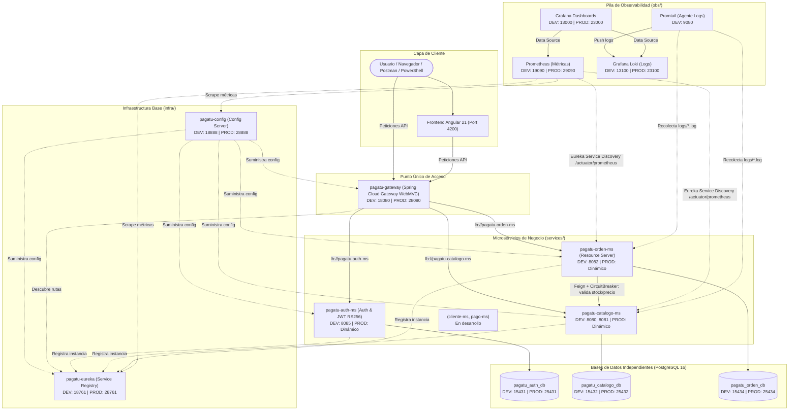

# 🛒 Pagatu — Sistema Distribuido de Comercio Electrónico

Sistema distribuido de comercio electrónico basado en microservicios, desarrollado para el curso **Desarrollo de Aplicaciones Distribuidas (DIST)** — Universidad Peruana Unión (UPeU) 2026-2.

El proyecto implementa una arquitectura cloud-native basada en **Spring Cloud**, **PostgreSQL**, **Docker**, **Observabilidad (Prometheus, Loki, Promtail, Grafana)** y un frontend en **Angular**.

---

## 📑 Documentación Oficial del Curso

El curso cuenta con documentación completa (sílabo, guías de laboratorio paso a paso y arquitectura detallada) publicada con MkDocs:

👉 **[Sitio Oficial de Documentación: 262dist.github.io/pagatu](https://262dist.github.io/pagatu/)**

---

## 🏛️ Mapa de Arquitectura e Infraestructura

El sistema desacopla la infraestructura compartida, los microservicios de negocio y la pila de observabilidad:



---

## 📊 Matriz de Puertos y Servicios

| Componente | Tipo | Puerto DEV (Host) | Puerto PROD Local (Host) | Base de Datos / Endpoint |
|---|---|---|---|---|
| **pagatu-config** | Infraestructura | `18888` | `28888` | `http://localhost:18888/actuator/health` |
| **pagatu-eureka** | Infraestructura | `18761` | `28761` | Dashboard: `http://localhost:18761/` |
| **pagatu-gateway** | Infraestructura / Resource Server | `18080` | `28080` | Gateway API: `http://localhost:18080/` |
| **pagatu-auth-ms** | Microservicio (Auth/JWT) | `8085` | Red interna Docker | JWKS: `/.well-known/jwks.json`, API: `/api/v1/auth/**` |
| **pagatu-catalogo-ms** | Microservicio | `8080` / `8081` | Red interna Docker | Swagger: `http://localhost:8080/swagger-ui.html` |
| **pagatu-orden-ms** | Microservicio / Resource Server | `8082` | Red interna Docker | Swagger: `http://localhost:8082/swagger-ui.html` |
| **PostgreSQL Auth** | Base de Datos | `15431` | `25431` | `pagatu_auth_db` (user/pwd: `pagatu`/`pagatu`) |
| **PostgreSQL Catálogo** | Base de Datos | `15432` | `25432` | `pagatu_catalogo_db` (user/pwd: `pagatu`/`pagatu`) |
| **PostgreSQL Órdenes** | Base de Datos | `15434` | `25434` | `pagatu_orden_db` (user/pwd: `pagatu`/`pagatu`) |
| **Prometheus** | Observabilidad | `19090` | `29090` | UI: `http://localhost:19090` |
| **Loki** | Observabilidad | `13100` | `23100` | Ingesta de logs |
| **Grafana** | Observabilidad | `13000` | `23000` | UI: `http://localhost:13000` (admin/admin) |
| **Frontend Angular** | Cliente | `4200` | `4200` | `http://localhost:4200` (planeado) |

---

## 🧩 Detalle de la Infraestructura

### 1. Servidor de Configuración Centralizada (`infra/pagatu-config`)
- **Tecnología**: Spring Cloud Config Server (`Spring Boot 4.x`, Java 21).
- **Modo**: Native local filesystem (`file:./config-repo`).
- **Función**: Elimina la dispersión de credenciales y variables. Cada microservicio descarga su configuración en el arranque consultando `optional:configserver:${CONFIG_SERVER_URL:http://localhost:18888}`.
- **Configuraciones disponibles en `config-repo/`**:
  - `pagatu-auth-ms-dev.yml` y `pagatu-auth-ms-prod.yml`
  - `pagatu-catalogo-ms-dev.yml` y `pagatu-catalogo-ms-prod.yml`
  - `pagatu-eureka-dev.yml` y `pagatu-eureka-prod.yml`
  - `pagatu-gateway-dev.yml` y `pagatu-gateway-prod.yml`
  - `pagatu-orden-ms-dev.yml` y `pagatu-orden-ms-prod.yml`

### 2. Registro y Descubrimiento de Servicios (`infra/pagatu-eureka`)
- **Tecnología**: Netflix Eureka Server (`Spring Cloud Netflix Eureka`).
- **Función**: Registro dinámico de instancias. Ningún microservicio se comunica con otro mediante IPs o puertos fijos; resuelven por `spring.application.name`.
- **Autodescubrimiento**: Permite escalabilidad horizontal en caliente (por ejemplo, múltiples instancias de `pagatu-catalogo-ms`).

### 3. API Gateway y Enrutador (`infra/pagatu-gateway`)
- **Tecnología**: Spring Cloud Gateway Server WebMVC + Spring Security OAuth2 Resource Server.
- **Función**: Punto único de entrada para clientes externos. Oculta la topología de la red interna, realiza balanceo de carga (`lb://`) y protege rutas según roles (`ADMIN`, `CLIENTE`) decodificando JWTs con el endpoint JWKS de `pagatu-auth-ms`.
- **Rutas configuradas**:
  - `/api/v1/auth/**` ➡️ `lb://pagatu-auth-ms` (Público)
  - `/api/v1/categorias/**` ➡️ `lb://pagatu-catalogo-ms` (GET público, mutaciones ADMIN)
  - `/api/v1/productos/**` ➡️ `lb://pagatu-catalogo-ms` (GET público, mutaciones ADMIN)
  - `/api/v1/ordenes/**` ➡️ `lb://pagatu-orden-ms` (Requiere rol CLIENTE o ADMIN)

---

## 🛠️ Microservicios Implementados

### 1. Autenticación y JWT (`services/pagatu-auth-ms`)
- **Responsabilidad**: Gestión de usuarios, roles y emisión de tokens asimétricos JWT (RS256).
- **Stack**: Java 21, Spring Boot 4.1.1, Spring Security, Spring Security OAuth2 JOSE (Nimbus), Spring Data JPA, Flyway, MapStruct, OpenAPI/Swagger.
- **Endpoints**: `POST /api/v1/auth/login`, `POST /api/v1/auth/registro`, `GET /.well-known/jwks.json`.
- **Persistencia**: PostgreSQL (`pagatu_auth_db`) con usuarios semilla (`admin@pagatu.com`, `cliente@pagatu.com`).

### 2. Catálogo (`services/pagatu-catalogo-ms`)
- **Responsabilidad**: Única fuente de verdad de categorías y productos.
- **Stack**: Java 21, Spring Boot 4.0.7, Spring Data JPA, Flyway, MapStruct, OpenAPI/Swagger, Actuator.
- **Persistencia**: PostgreSQL con migraciones versionadas (`V1__create_catalogo_tables.sql`, `V2__seed_categorias_productos.sql`).

### 3. Órdenes (`services/pagatu-orden-ms`)
- **Responsabilidad**: Gestión de órdenes y compras protegido como OAuth2 Resource Server.
- **Stack**: Java 21, Spring Boot 4.1.1, Spring Security OAuth2 Resource Server, OpenFeign, Resilience4j Circuit Breaker, PostgreSQL, Flyway.
- **Seguridad**: Extrae el claim `idCliente` del token JWT verificado en tiempo de ejecución, impidiendo suplantaciones de identidad.

---

## 📈 Observabilidad Centralizada (`obs/`)

La observabilidad no es una dependencia para arrancar el negocio, sino una capa exterior que monitoriza todo el sistema:

1. **Prometheus**:
   - Descubre dinámicamente los microservicios usando **Eureka Service Discovery** (`eureka_sd_configs: http://host.docker.internal:18761/eureka`), además de scrapear endpoints de infraestructura.
2. **Grafana Loki & Promtail**:
   - `Promtail` rastrea los archivos `.log` en disco generados por los microservicios con `Correlation-Id` y los envía a `Loki`.
3. **Grafana**:
   - Provisionamiento como código de Data Sources (Prometheus y Loki) y tableros unificados para correlacionar métricas de rendimiento con logs de error.

---

## 🚀 Guía de Ejecución en Entorno de Desarrollo (DEV)

Para levantar el ecosistema completo en modo desarrollo local:

### Paso 1: Levantar Bases de Datos y Observabilidad (Docker)
```powershell
# Base de datos de Catálogo
cd "services/pagatu-catalogo-ms"
docker compose -f compose-dev.yml up -d

# Base de datos de Órdenes
cd "../../services/pagatu-orden-ms"
docker compose -f compose-dev.yml up -d

# Observabilidad (Prometheus, Loki, Promtail, Grafana)
cd "../../obs"
docker compose -f compose-dev.yml up -d
```

### Paso 2: Levantar la Infraestructura Base (Host con Maven Wrapper)
En terminales independientes:

```powershell
# 1. Config Server (Esperar a que esté en verde en http://localhost:18888/actuator/health)
cd "infra/pagatu-config"
.\mvnw.cmd spring-boot:run

# 2. Eureka Server (Dashboard en http://localhost:18761)
cd "infra/pagatu-eureka"
.\mvnw.cmd spring-boot:run

# 3. Gateway (Enrutador en http://localhost:18080)
cd "infra/pagatu-gateway"
.\mvnw.cmd spring-boot:run
```

### Paso 3: Levantar los Microservicios de Negocio
En terminales independientes:

```powershell
# Microservicio Catálogo (Instancia 1 en puerto 8080)
cd "services/pagatu-catalogo-ms"
.\mvnw.cmd spring-boot:run

# Microservicio Órdenes (Instancia en puerto 8082)
cd "services/pagatu-orden-ms"
.\mvnw.cmd spring-boot:run
```

### Paso 4: Validar el Funcionamiento End-to-End
Consulta las APIs a través del **Gateway** (puerto `18080`):

```powershell
# Listar productos a través del Gateway
Invoke-RestMethod -Method Get -Uri "http://localhost:18080/api/v1/productos"

# Listar categorías a través del Gateway
Invoke-RestMethod -Method Get -Uri "http://localhost:18080/api/v1/categorias"

# Consultar métricas en Prometheus
Invoke-RestMethod -Method Get -Uri "http://localhost:19090"
```

---

## 📁 Estructura del Repositorio

```text
pagatu/
├── docs/                       # Documentación del curso (MkDocs) y guías paso a paso
│   ├── sesiones/               # Sesiones de clase (S01 a S15)
│   ├── proyecto-sello/         # Alcances y rúbricas del proyecto
│   └── propuesta-proyecto/     # Arquitectura de referencia
├── infra/                      # Componentes de infraestructura compartida
│   ├── pagatu-config/          # Config Server (Spring Cloud Config) + config-repo/
│   ├── pagatu-eureka/          # Service Registry (Netflix Eureka)
│   ├── pagatu-gateway/         # API Gateway (Spring Cloud Gateway WebMVC)
│   └── compose.yml             # Despliegue en red Docker compartida (pagatu-prod-net)
├── services/                   # Microservicios de negocio
│   ├── pagatu-catalogo-ms/     # Microservicio de categorías y productos
│   └── pagatu-orden-ms/        # Microservicio de órdenes de compra
├── obs/                        # Pila de observabilidad
│   ├── grafana/                # Provisionamiento de Datasources y Dashboards
│   ├── prometheus/             # Configuraciones con Eureka Service Discovery
│   ├── promtail/               # Agente recolector de logs
│   ├── compose-dev.yml         # Compose de observabilidad en DEV
│   └── compose.yml             # Compose de observabilidad en red compartida
└── README.md                   # Esta guía general
```

---

## 💡 Tecnologías Utilizadas

- **Lenguaje**: Java 21 (LTS)
- **Framework Principal**: Spring Boot 4.0.7 / 4.0.8
- **Ecosistema Distribuido**: Spring Cloud 2025.1.x (*Oakwood*)
  - Spring Cloud Config
  - Spring Cloud Netflix Eureka
  - Spring Cloud Gateway Server WebMVC
  - Spring Cloud OpenFeign
- **Resiliencia**: Resilience4j (Circuit Breaker)
- **Persistencia**: PostgreSQL 16 Alpine, Spring Data JPA, Hibernate, Flyway
- **Mapeo y Utilidades**: MapStruct 1.6, Lombok
- **Documentación de API**: SpringDoc OpenAPI 3.0 / Swagger UI
- **Observabilidad**: Prometheus, Grafana Loki, Promtail, Grafana, Micrometer
- **Contenedores**: Docker & Docker Compose
